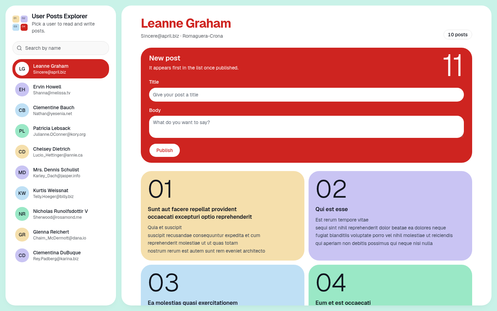
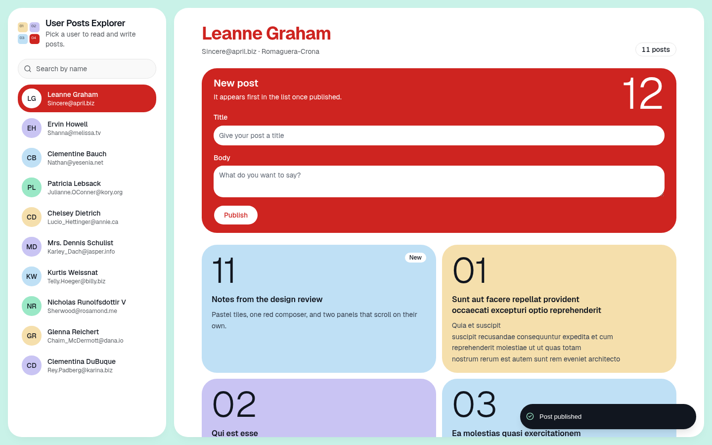
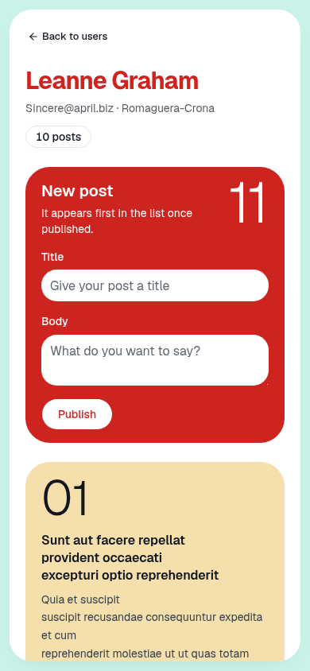

<p align="center">
  
</p>

<h1 align="center">User Posts Explorer</h1>

<p align="center">
  A small React + TypeScript app on top of the public
  <a href="https://jsonplaceholder.typicode.com">JSONPlaceholder</a> API: search users, read their posts, publish a new one.
  <br />
  Built as a Frontend React technical assessment (3-hour budget).
</p>



## Features

| Requirement                         | Where to see it                                                                                                              |
| ----------------------------------- | ---------------------------------------------------------------------------------------------------------------------------- |
| User list with search by name       | Left sidebar; case-insensitive substring match, with an explicit "No users match" state                                      |
| A user's posts                      | Click a user: numbered post tiles in the right panel, which scrolls independently of the sidebar                             |
| Create a post with a validated form | The red "New post" tile; title and body are required (whitespace-only is rejected)                                           |
| New post appears in the list        | It lands first with a "New" badge (the API does not persist it, so it lives in the client cache)                             |
| Visible loading and error states    | Skeletons while loading; alerts with **Retry** for failed loads; an inline error that keeps your input when publishing fails |
| Tests                               | 25 tests with Vitest + Testing Library + MSW                                                                                 |

<details>
<summary>More screenshots</summary>

After publishing a post (the new post is numbered 11 and shown first; the composer moves on to 12):



Mobile (one panel at a time, with a back button):



</details>

## How to run

**Requirements:** Node 24 LTS (any Node ≥ 22.12 works; Vitest 5, jsdom and MSW 3 need it). The repo pins it in `mise.toml` and `.nvmrc`.

```bash
mise install        # or: nvm use
npm install
npm run dev         # http://localhost:5173
```

| Command            | What it does                  |
| ------------------ | ----------------------------- |
| `npm run dev`      | Dev server                    |
| `npm test`         | Vitest in watch mode          |
| `npm run test:run` | Single test run (25 tests)    |
| `npm run build`    | Type-check + production build |
| `npm run lint`     | oxlint                        |
| `npm run format`   | Prettier                      |

## Decisions

**Spec first.** Before any code I wrote short specs in [`docs/`](docs): [PRD](docs/PRD.md) (scope and acceptance criteria AC-1…AC-8), [TRD](docs/TRD.md) (stack and architecture), [UI-UX](docs/UI-UX.md), [FLOW](docs/FLOW.md), [DATA](docs/DATA.md) (types and API contract) and [PLAN](docs/PLAN.md) (build order). [`CLAUDE.md`](CLAUDE.md) holds the rules the AI agent had to follow. Then I built phase by phase, approving a plan before each one.

**Stack**

- **Vite + React + TypeScript (`strict`).** No SSR or routing needs, so Next.js would add setup without value.
- **TanStack Query** for server state: loading, error, retry and caching out of the box, and no race conditions when switching users quickly (each user has its own query key).
- **React Hook Form + Zod.** The schema is the single source of truth for validation _and_ types (`z.infer`); `.trim()` makes whitespace-only input invalid.
- **Tailwind CSS v4 + shadcn/ui.** Accessible primitives whose code lives in the repo, themed with project tokens.
- **Vitest + Testing Library + MSW.** Tests go through the real `fetch` path; no mocked hooks.

**Architecture**

- **Feature folders** (`src/features/users`, `src/features/posts`) with a **container / presentational** split: containers call hooks, presentational components only receive props.
- **The features never import each other.** Only `App.tsx` composes them. The posts feature declares its own `PostAuthor` type (id, name, email, company); `App` passes a `User`, which TypeScript accepts structurally.
- **Pure logic is framework-free** (`filterUsers`, `postSchema`, `describeError`), so it is unit-tested directly.

**Notable details**

- **`POST /posts` always returns `id: 101` and saves nothing.** On success the post gets a local `crypto.randomUUID()` id (no duplicate React keys) and is prepended to the user's cached posts with `setQueryData`. `invalidateQueries` would refetch and lose it. `onSuccess` uses the `userId` captured at submit time, so the post lands in the right list even if you switch users before the response.
- **`staleTime: Infinity`.** The API data never changes, and it keeps locally created posts alive when you revisit a user during the session.
- **No router.** Two views side by side don't need one; the trade-off (no shareable URLs) is listed below.
- **Errors explain what to do.** "Check your connection and try again", or the HTTP status for server errors, never the raw browser message.
- **Accessibility.** WCAG AA contrast (computed from the theme tokens), labelled controls, `role="status"` / `role="alert"` regions, keyboard order, and managed focus on mobile when switching panels.
- **TDD.** For logic and key behaviors I committed the failing test first (`test:`) and then the implementation (`feat:`), so the history shows each RED → GREEN step.

**Design.** The visual direction comes from a reference I chose (a promo calendar with pastel numbered tiles). I used the Impeccable design skill for Claude Code: product context in [`PRODUCT.md`](PRODUCT.md), a written direction contract, an independent design review, and the resulting system documented in [`DESIGN.md`](DESIGN.md). The tiles carry no arrows like the reference does, because posts are not clickable and an arrow would promise an action that does not exist.

## What I'd do with more time

- **URL routing** (`/users/:id`) for shareable links and browser back/forward.
- **Optimistic updates** for post creation, with rollback on error.
- **Persist created posts** across reloads (TanStack Query persister + `localStorage`).
- **Scale to real data volumes:** server-side pagination with `useInfiniteQuery`, server-side search with debounce, and list virtualization.
- **E2E tests** with Playwright for the full flow, plus visual regression on the screenshots.
- **CI** (GitHub Actions running lint, type-check, tests and build on every push).
- **Dark mode** and **i18n**.
- **Error monitoring** (e.g. Sentry) and a global error boundary.

## How I used AI

I worked with Claude Code (Claude Opus) as a pair: **I directed, the AI executed, and every step went through my review.** The spec documents and `CLAUDE.md` were the main tool: they gave the agent explicit scope, stack and rules, so it didn't have to guess. Each build phase started in planning mode and waited for my approval before any code was written.

**What I asked for**

- Drafting the six spec documents from the assessment brief, then `CLAUDE.md` with the agent rules.
- Planning and implementing each phase with TDD and incremental conventional commits.
- A visual redesign from a reference image, with independent design and code reviews.
- A running log of decisions and likely interview questions.

**What I accepted**

- The overall spec structure, the acceptance criteria table, and the early detection of the `id: 101` pitfall.
- TanStack Query for server state, after weighing it against hand-rolled `useEffect` fetching.
- MSW for tests, the `PostAuthor` contract to keep features decoupled, and an extra test for the HTTP client that the plan did not include.
- The design direction, after confirming it in writing before anything was built.

**What I corrected or decided myself**

| Topic          | AI proposal or behavior                                   | My correction / decision                                                                       |
| -------------- | --------------------------------------------------------- | ---------------------------------------------------------------------------------------------- |
| Styling        | CSS Modules                                               | Tailwind CSS v4 + shadcn/ui                                                                    |
| Forms          | Manual validation with a pure function                    | React Hook Form + Zod                                                                          |
| "Backend" doc  | A backend spec for an app with no backend                 | I questioned it; it became `docs/DATA.md` (data model + API contract)                          |
| Scope          | Long documents                                            | Kept them short because of the 3-hour budget                                                   |
| Design         | Arrows on tiles, copied from the reference                | Removed: posts are not clickable                                                               |
| Commit hygiene | Chained commands with `;`, which committed a broken build | Caught in the output; fixed and amended **before** pushing (pushed history is never rewritten) |
| Contrast       | Reported muted text at ~6:1                               | The independent review measured ~4.7:1; the token was darkened to ~7:1                         |

**Things the AI caught or worked around that I verified:** the installed Node 20 could not run Vitest 5 / jsdom / MSW 3 (pinned Node 24); the current Vite template ships oxlint and TypeScript 7 (no `baseUrl`); shadcn's `radix-nova` registry no longer has the `form` component (used `field` + RHF `Controller`); MSW 3 renamed `onUnhandledRequest` to `onUnhandledFrame`; and shadcn components import `cn` from an npm package, which I checked was the official shadcn one before accepting it.

## Project structure

```
src/
├── App.tsx                 # composes the two features; selection + panels
├── features/
│   ├── users/              # api, types, useUsers, filterUsers, components
│   └── posts/              # api, types, usePosts, useCreatePost, postSchema, components
├── shared/                 # api client, LoadingState, ErrorState, AppLogo, tile helper
├── components/ui/          # shadcn primitives
└── test/                   # MSW server, handlers, fixtures, render helper
docs/                       # PRD, TRD, UI-UX, FLOW, DATA, PLAN, screenshots
```
