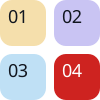

<p align="center">
  
</p>

<h1 align="center">User Posts Explorer</h1>

<p align="center">
  Una pequeña app en React + TypeScript sobre la API pública
  <a href="https://jsonplaceholder.typicode.com">JSONPlaceholder</a>: buscar usuarios, leer sus publicaciones y crear una nueva.
  <br />
  Desarrollada como prueba técnica para una posición de Frontend React (tiempo máximo: 3 horas).
</p>

<p align="center">
  <sub>
    Tiempo de desarrollo: unas <strong>2 h 45 min</strong> de trabajo efectivo en dos sesiones.
    Los requisitos del enunciado quedaron completos en <strong>~1 h 45 min</strong>; el resto se dedicó a
    rediseño, accesibilidad, README y despliegue.
  </sub>
</p>

<p align="center">
  <a href="https://user-posts-explorer-sigma.vercel.app"><strong>Ver la demo en vivo →</strong></a>
</p>


## Funcionalidades

| Requisito                                     | Dónde verlo                                                                                                                           |
| --------------------------------------------- | ------------------------------------------------------------------------------------------------------------------------------------- |
| Lista de usuarios con búsqueda por nombre     | Barra lateral izquierda; coincidencia parcial sin distinguir mayúsculas, con un estado explícito "No users match"                     |
| Publicaciones de un usuario                   | Al elegir un usuario: tarjetas numeradas en el panel derecho, que tiene su propio scroll, independiente de la barra lateral           |
| Crear una publicación con formulario validado | La tarjeta roja "New post"; título y texto son obligatorios (no se aceptan valores con solo espacios)                                 |
| La nueva publicación aparece en la lista      | Aparece primera, con la etiqueta "New" (la API no la guarda, así que vive en la caché del cliente)                                    |
| Estados de carga y de error visibles          | Skeletons mientras carga; alertas con **Retry** si falla una carga; un error en línea que conserva lo escrito si falla la publicación |
| Tests                                         | 25 tests con Vitest + Testing Library + MSW                                                                                           |

La interfaz está en inglés, como define [`CLAUDE.md`](CLAUDE.md); la documentación de producto y técnica en [`docs/`](docs) también.

<details>
<summary>Más capturas</summary>

Después de publicar (la nueva publicación lleva el número 11 y aparece primera; el formulario pasa a mostrar el 12):


Móvil (un panel a la vez, con botón para volver):


</details>

## Cómo ejecutarlo

**Requisitos:** Node 24 LTS (sirve cualquier Node ≥ 22.12; lo exigen Vitest 5, jsdom y MSW 3). El repositorio lo fija en `mise.toml` y `.nvmrc`.

```bash
mise install        # o bien: nvm use
npm install
npm run dev         # http://localhost:5173
```

| Comando            | Qué hace                               |
| ------------------ | -------------------------------------- |
| `npm run dev`      | Servidor de desarrollo                 |
| `npm test`         | Vitest en modo watch                   |
| `npm run test:run` | Ejecuta los tests una vez (25 tests)   |
| `npm run build`    | Chequeo de tipos + build de producción |
| `npm run lint`     | oxlint                                 |
| `npm run format`   | Prettier                               |

## Decisiones

**Primero la especificación.** Antes de escribir código redacté especificaciones cortas en [`docs/`](docs): [PRD](docs/PRD.md) (alcance y criterios de aceptación AC-1…AC-8), [TRD](docs/TRD.md) (stack y arquitectura), [UI-UX](docs/UI-UX.md), [FLOW](docs/FLOW.md), [DATA](docs/DATA.md) (tipos y contrato de la API) y [PLAN](docs/PLAN.md) (orden de construcción). [`CLAUDE.md`](CLAUDE.md) contiene las reglas que tenía que seguir el agente de IA. Después construí fase por fase, aprobando un plan antes de cada una.

**Stack**

- **Vite + React + TypeScript (`strict`).** No hacían falta SSR ni rutas, así que Next.js sumaba configuración sin aportar valor.
- **TanStack Query** para el estado del servidor: carga, error, reintento y caché resueltos, y sin condiciones de carrera al cambiar rápido de usuario (cada usuario tiene su propia query key).
- **React Hook Form + Zod.** El schema es la única fuente de verdad para la validación _y_ para los tipos (`z.infer`); `.trim()` hace que un valor con solo espacios sea inválido.
- **Tailwind CSS v4 + shadcn/ui.** Componentes accesibles cuyo código vive en el repositorio, personalizados con tokens propios.
- **Vitest + Testing Library + MSW.** Los tests pasan por el `fetch` real; no se mockean hooks.

**Arquitectura**

- **Carpetas por feature** (`src/features/users`, `src/features/posts`) con separación **contenedor / presentacional**: los contenedores usan los hooks y los presentacionales solo reciben props.
- **Las features nunca se importan entre sí.** Solo `App.tsx` las compone. La feature de posts declara su propio tipo `PostAuthor` (id, name, email, company); `App` le pasa un `User`, que TypeScript acepta por tipado estructural.
- **La lógica pura no depende de React** (`filterUsers`, `postSchema`, `describeError`), así que se testea directamente.

**Detalles destacables**

- **`POST /posts` siempre devuelve `id: 101` y no guarda nada.** Al confirmarse, la publicación recibe un id local con `crypto.randomUUID()` (sin keys duplicadas en React) y se agrega al principio de la caché del usuario con `setQueryData`. `invalidateQueries` volvería a pedir los datos y la perdería. `onSuccess` usa el `userId` capturado al enviar, así que la publicación cae en la lista correcta aunque cambies de usuario antes de la respuesta.
- **`staleTime: Infinity`.** Los datos de la API nunca cambian, y así las publicaciones creadas se mantienen al volver a un usuario durante la sesión.
- **Sin router.** Dos vistas lado a lado no lo necesitan; la contrapartida (no hay URLs para compartir) figura más abajo.
- **Los errores dicen qué hacer.** "Check your connection and try again", o el código HTTP si el error es del servidor; nunca el mensaje crudo del navegador.
- **Accesibilidad.** Contraste WCAG AA (calculado sobre los tokens del tema), controles con label, regiones `role="status"` / `role="alert"`, orden de teclado lógico y foco gestionado en móvil al cambiar de panel.
- **TDD.** Para la lógica y los comportamientos clave hice primero el commit del test que fallaba (`test:`) y después el de la implementación (`feat:`), así el historial muestra cada paso RED → GREEN.

**Diseño.** La dirección visual sale de una referencia que elegí (un calendario promocional con tarjetas pastel numeradas). Usé el skill de diseño Impeccable para Claude Code: contexto de producto en [`PRODUCT.md`](PRODUCT.md), un contrato de dirección escrito, una revisión de diseño independiente y el sistema resultante documentado en [`DESIGN.md`](DESIGN.md). A diferencia de la referencia, las tarjetas no llevan flechas: las publicaciones no son clickeables y una flecha prometería una acción que no existe.

## Qué haría con más tiempo

- **Rutas en la URL** (`/users/:id`) para poder compartir enlaces y usar atrás/adelante del navegador.
- **Actualizaciones optimistas** al crear publicaciones, con rollback si falla.
- **Persistir las publicaciones creadas** al recargar (persister de TanStack Query + `localStorage`).
- **Escalar a volúmenes reales:** paginación del lado del servidor con `useInfiniteQuery`, búsqueda en el servidor con debounce y virtualización de listas.
- **Tests E2E** con Playwright para el flujo completo, más regresión visual sobre las capturas.
- **CI** (GitHub Actions con lint, chequeo de tipos, tests y build en cada push).
- **Modo oscuro** e **internacionalización**.
- **Monitoreo de errores** (por ejemplo, Sentry) y un error boundary global.

## Cómo usé la IA

Trabajé con Claude Code (Claude Opus) como pareja de programación: **yo dirigí, la IA ejecutó y cada paso pasó por mi revisión.** Los documentos de especificación y `CLAUDE.md` fueron la herramienta principal: le dieron al agente un alcance, un stack y reglas explícitas, para que no tuviera que adivinar. Cada fase empezó en modo planificación y esperó mi aprobación antes de escribir código.

**Qué le pedí**

- Redactar los seis documentos de especificación a partir del enunciado, y después `CLAUDE.md` con las reglas para el agente.
- Planificar e implementar cada fase con TDD y commits convencionales incrementales.
- Un rediseño visual a partir de una imagen de referencia, con revisiones independientes de diseño y de código.
- Un registro de decisiones y de posibles preguntas de entrevista.

**Qué acepté**

- La estructura general de las especificaciones, la tabla de criterios de aceptación y la detección temprana del problema del `id: 101`.
- TanStack Query para el estado del servidor, después de compararlo con hacer el fetching a mano con `useEffect`.
- MSW para los tests, el contrato `PostAuthor` para mantener desacopladas las features y un test extra del cliente HTTP que el plan no incluía.
- La dirección de diseño, después de confirmarla por escrito antes de construir nada.

**Qué corregí o decidí yo**

| Tema                | Propuesta o comportamiento de la IA                             | Mi corrección / decisión                                                                                   |
| ------------------- | --------------------------------------------------------------- | ---------------------------------------------------------------------------------------------------------- |
| Estilos             | CSS Modules                                                     | Tailwind CSS v4 + shadcn/ui                                                                                |
| Formularios         | Validación manual con una función pura                          | React Hook Form + Zod                                                                                      |
| Documento "Backend" | Una especificación de backend para una app que no tiene backend | Lo cuestioné; pasó a ser `docs/DATA.md` (modelo de datos + contrato de la API)                             |
| Alcance             | Documentos largos                                               | Los mantuve cortos por el límite de 3 horas                                                                |
| Diseño              | Flechas en las tarjetas, copiadas de la referencia              | Eliminadas: las publicaciones no son clickeables                                                           |
| Higiene de commits  | Encadenó comandos con `;` y se commiteó un build roto           | Lo detecté en la salida; se corrigió y enmendó **antes** del push (nunca se reescribe historial publicado) |
| Contraste           | Informó que el texto secundario tenía ~6:1                      | La revisión independiente midió ~4.7:1; se oscureció el token hasta ~7:1                                   |

**Cosas que la IA detectó o resolvió y que yo verifiqué:** el Node 20 instalado no podía correr Vitest 5 / jsdom / MSW 3 (se fijó Node 24); la plantilla actual de Vite trae oxlint y TypeScript 7 (sin `baseUrl`); el registro `radix-nova` de shadcn ya no incluye el componente `form` (se usó `field` + `Controller` de RHF); MSW 3 renombró `onUnhandledRequest` a `onUnhandledFrame`; y los componentes de shadcn importan `cn` desde un paquete npm, que verifiqué que fuera el oficial de shadcn antes de aceptarlo.

## Estructura del proyecto

```
src/
├── App.tsx                 # compone las dos features; selección y paneles
├── features/
│   ├── users/              # api, types, useUsers, filterUsers, componentes
│   └── posts/              # api, types, usePosts, useCreatePost, postSchema, componentes
├── shared/                 # cliente de API, LoadingState, ErrorState, AppLogo, helper de tarjetas
├── components/ui/          # componentes base de shadcn
└── test/                   # servidor MSW, handlers, fixtures, helper de render
docs/                       # PRD, TRD, UI-UX, FLOW, DATA, PLAN, capturas
```
